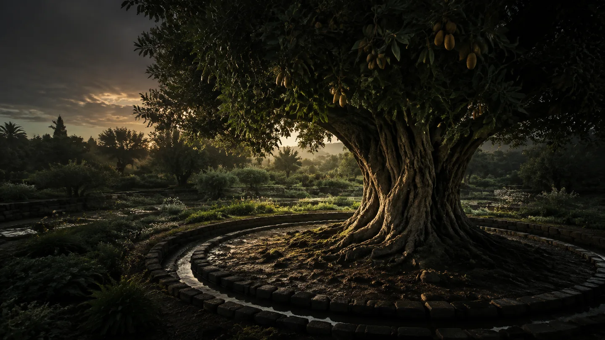
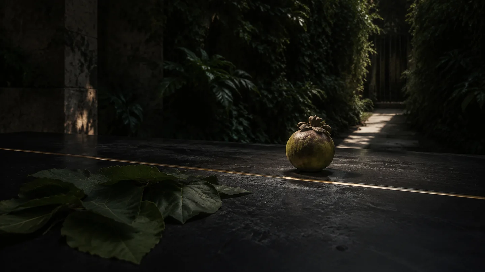
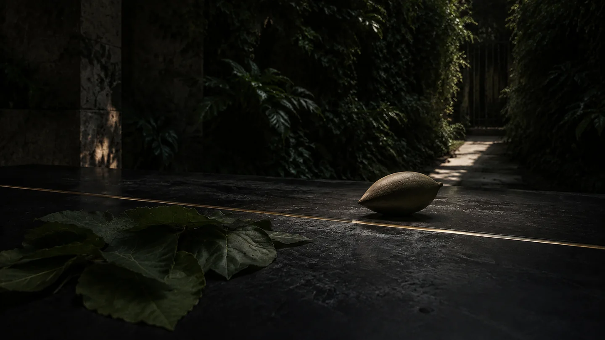
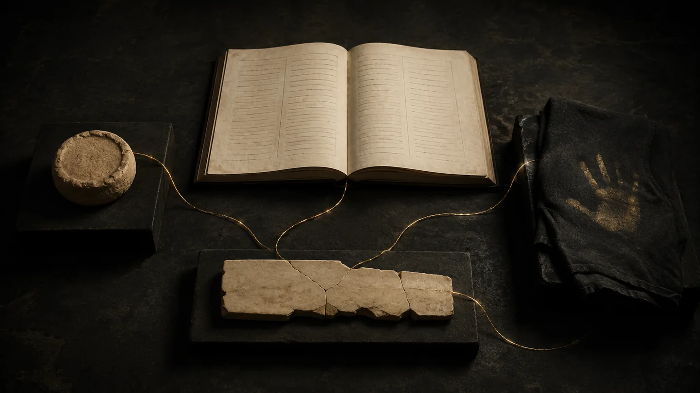
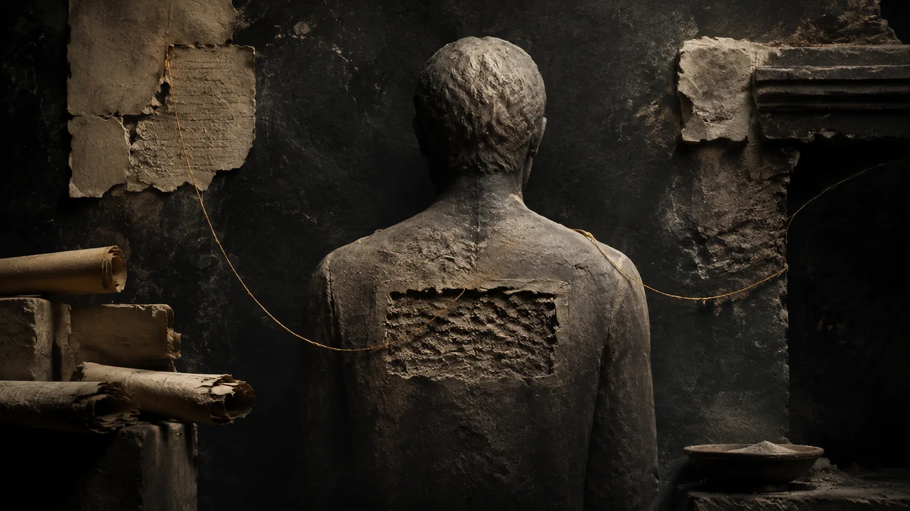
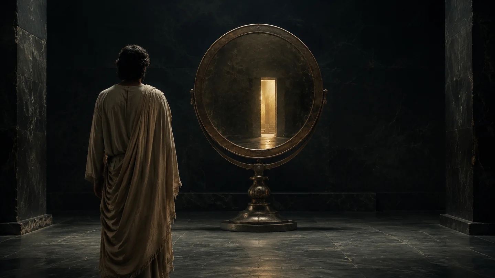
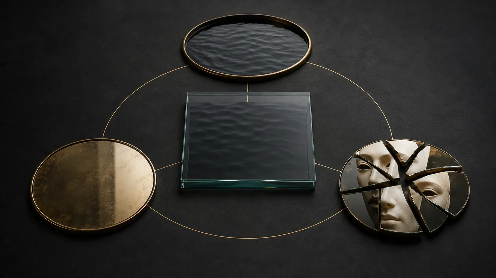
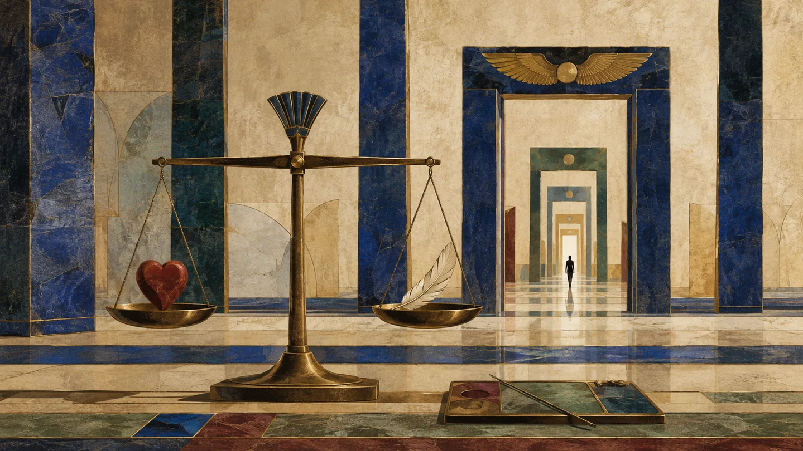
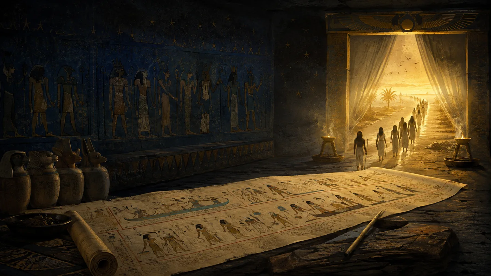
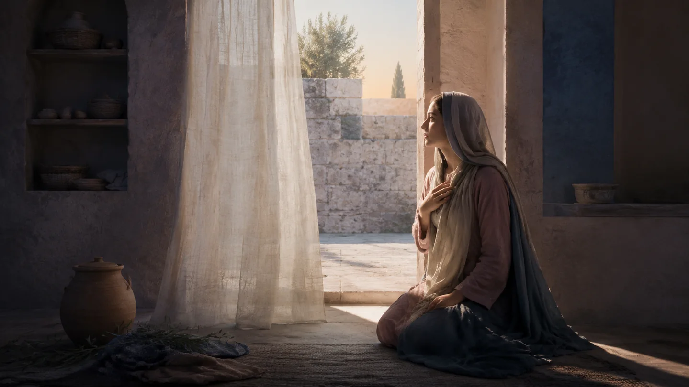

# ELOAH · Galerie des 15 visuels retrouvés

**Foi & Spiritualité — collection d'images originales de nos travaux ELOAH.** Ces quinze images PNG ont été retrouvées dans la bibliothèque antérieure. Les versions affichées ici sont des copies WebP optimisées pour le mobile ; les PNG originaux sont conservés séparément dans l'archive de sauvegarde.

> **Nature des images : créations éditoriales ELOAH, pas photographies authentifiées d'objets historiques ni fac-similés des manuscrits évoqués dans les études.** Chaque image garde son titre d'origine.

[← Retour au registre des archives](foi-control.html?file=eloah-foi-archives-completes-index.md)

## Le jardin, l'arbre et l'interdit

[Lire le dossier de recherche](foi-control.html?file=eloah-foi-source-jardin-arbre-interdit.md)

*Le jardin, l’arbre et l’interdit.png — visuel éditorial d'origine, version WebP optimisée.*

*Le fruit derrière la ligne d’or.png — visuel éditorial d'origine, version WebP optimisée.*

*Gousse ancienne sur table de basalte.png — visuel éditorial d'origine, version WebP optimisée.*

## Le sommeil et les rêves

[Lire le dossier de recherche](foi-control.html?file=eloah-foi-source-sommeil-prophetes.md)

*Sommeil sous la lumière dorée.png — visuel éditorial d'origine, version WebP optimisée.*

*Fragments de rêves et fil d’or.png — visuel éditorial d'origine, version WebP optimisée.*

## Le nom et les objets anciens

[Lire le dossier de recherche](foi-control.html?file=eloah-foi-source-nom-efface-identite.md)

*Objets anonymes reliés par l’or.png — visuel éditorial d'origine, version WebP optimisée.*

*Trace d’or dans la pierre.png — visuel éditorial d'origine, version WebP optimisée.*

## La reine de Saba

[Lire le dossier de recherche](foi-control.html?file=eloah-foi-source-reine-de-saba.md)

*Reine de Saba, quête de sagesse.png — visuel éditorial d'origine, version WebP optimisée.*

*Quatre strates de la reine de Saba.png — visuel éditorial d'origine, version WebP optimisée.*

*Cabinet de curiosités aux reliques anciennes.png — visuel éditorial d'origine, version WebP optimisée.*

## Le miroir

[Lire le dossier de recherche](foi-control.html?file=eloah-foi-source-miroir-verite-illusion.md)

*Le miroir et la porte de lumière.png — visuel éditorial d'origine, version WebP optimisée.*

*Quatre reflets, un masque fragmenté.png — visuel éditorial d'origine, version WebP optimisée.*

## Le Livre des morts

[Lire le dossier de recherche](foi-control.html?file=eloah-foi-source-livre-morts-egyptien.md)

*Le cœur et la plume.png — visuel éditorial d'origine, version WebP optimisée.*

*Le papyrus vers la lumière.png — visuel éditorial d'origine, version WebP optimisée.*

## Marie et les traditions

[Lire le dossier de recherche](foi-control.html?file=eloah-foi-source-marie-deux-ecritures.md)

*Marie à l’écoute de la Parole.png — visuel éditorial d'origine, version WebP optimisée.*

---

### Traçabilité

Tous les visuels ont été exportés à partir des PNG originaux retrouvés, sans génération de nouvelles scènes. Le dossier `assets/foi-archives/` contient les 15 WebP et `manifest.json` assure la correspondance exacte avec les noms originaux. Les anciens scans de manuscrits annoncés par ELOAH Scanner sont un autre corpus, non restauré par ces images.
