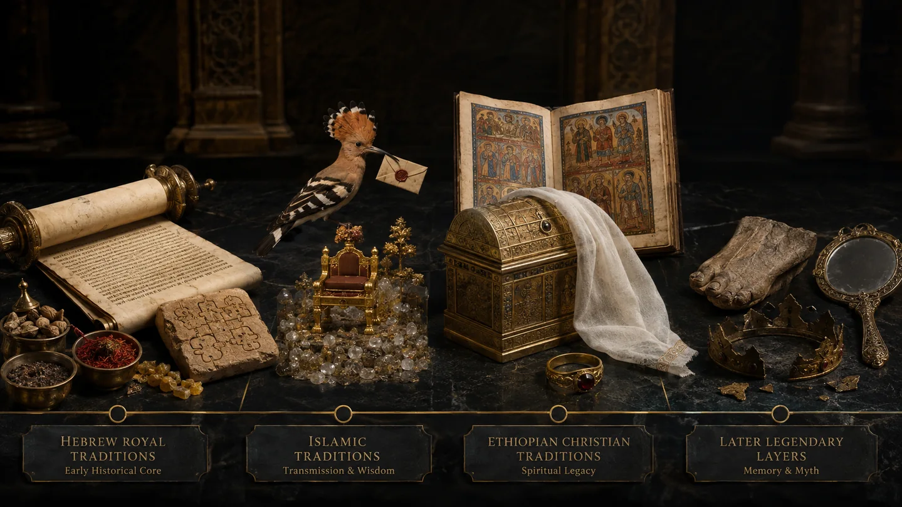
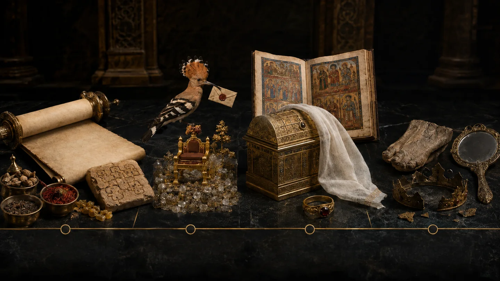

# ELOAH SCANNER — Texte original récupéré · La reine de Saba — La femme qui éprouve la sagesse | ELOAH

> **ARCHIVE DE LA PUBLICATION D'ORIGINE.** Contenu récupéré le 13 octobre 2026 sans réécriture depuis [la publication ELOAH Scanner](https://eloah-scanner.soniacointe.chatgpt.site/publications/reine-saba-bilqis-makeda). La conversion HTML → Markdown peut modifier la présentation et ne garantit pas que tous les fichiers images soient inclus. [Index de Foi & Spiritualité](foi-control.html?file=eloah-foi-archives-completes-index.md).

---

## Visuels ELOAH retrouvés et réintégrés

Ces images proviennent des créations éditoriales ELOAH retrouvées dans la bibliothèque originale et remises en ligne en WebP optimisé. **Ce ne sont ni des photographies de manuscrits antiques, ni des reconstitutions archéologiques établies.** [Voir toute la galerie](foi-control.html?file=eloah-foi-galerie-originaux.md).

*Reine de Saba, quête de sagesse — création éditoriale ELOAH, fichier antérieur retrouvé.*

*Quatre strates de la reine de Saba — création éditoriale ELOAH, fichier antérieur retrouvé.*

*Cabinet de curiosités aux reliques anciennes — création éditoriale ELOAH, fichier antérieur retrouvé.*

[ELOAH·](/)

ELOAH · Reines & Sagesse · I

מַלְכַּת שְׁבָא · مَلِكَة سَبَإ · ማክዳ

# La reine de Saba

La femme qui éprouve la sagesse — Bible, Coran, traditions éthiopiennes et légendes autour de Bilqīs et Makeda.

ELOAH · 32 scans · 5 annexes · 2026 · ~44 min

SABA
BILQĪS
MAKEDA
SAGESSE

## 0 · PROLOGUE

### Une femme célèbre dont les textes taisent le nom

Elle est l’une des femmes les plus célèbres des traditions abrahamiques. Des peintres lui ont donné un visage, des royaumes lui ont donné une généalogie, des commentaires lui ont attribué des jambes singulières, des récits impériaux lui ont donné un fils et des nations ont fait d’elle une ancêtre. Pourtant, dans la Bible comme dans le Coran, **elle n’a pas de nom propre**.

Le livre des Rois l’appelle **la reine de Saba**. Le Coran parle d’**une femme qui règne sur eux**. *Bilqīs* appartient à la tradition islamique postérieure ; *Makeda* à la grande mémoire littéraire éthiopienne du *Kebra Nagast*. Ces noms ne sont pas faux dans leur bibliothèque respective. Ils deviennent trompeurs lorsqu’on les projette sans indication dans les textes qui ne les donnent pas.

Cette absence de nom n’efface pas la reine. Elle déplace notre attention vers sa fonction. Elle entend un rapport, se met en route, questionne, observe, compare, consulte, négocie et décide. Dans les deux récits fondateurs, elle n’est pas uniquement l’objet du regard de Salomon : **elle est un sujet qui vérifie**.

> **La reine de Saba ne reçoit pas passivement la sagesse : elle la met à l’épreuve avant de reconnaître ce qu’elle a vu.**

---

## 1 · QUATRE BIBLIOTHÈQUES

### Une reine, plusieurs constructions

| CORPUS | DÉSIGNATION | FONCTION PRINCIPALE |
| --- | --- | --- |
| 1 Rois 10 / 2 Chroniques 9 | reine de Saba | éprouver et attester la sagesse de Salomon |
| Coran 27 | une femme régnant sur Saba | gouverner, discerner puis se soumettre à Dieu |
| Tafsīrs et récits islamiques | Bilqīs | compléter son identité, sa généalogie et son apparence |
| *Kebra Nagast* | Makeda | devenir mère de Menelik et origine de la royauté salomonienne éthiopienne |

À ces quatre ensembles s’ajoutent Josèphe, le Nouveau Testament, les traditions juives, les récits arabes, l’art européen et les usages politiques modernes. Il n’existe donc pas une biographie continue dont chaque tradition posséderait un morceau. Il existe plusieurs opérations : louer Salomon, montrer une souveraine lucide, expliquer une conversion, fonder une dynastie ou mettre en scène la rencontre de deux puissances.

---

## 2 · SABA

### Un royaume avant d’être une reine

**Saba** renvoie au royaume sudarabique généralement associé aux Sabéens et au territoire de l’actuel Yémen. Les inscriptions sudarabiques, les temples, les ouvrages hydrauliques et les réseaux caravaniers témoignent d’une civilisation réelle et puissante. Les produits aromatiques — encens et myrrhe notamment — circulaient entre l’Arabie du Sud, la Corne de l’Afrique et la Méditerranée.

Cette réalité ne prouve pas à elle seule l’historicité de la rencontre avec Salomon. Aucun document contemporain connu ne nomme la visiteuse de 1 Rois 10. L’archéologie atteste un monde susceptible de rendre le récit intelligible : richesse, commerce lointain, diplomatie et pouvoir royal. Elle ne fournit pas encore le passeport de la reine.

Formulation prudente : **Saba est historique ; la reine du récit demeure historiquement non identifiée**.

---

## 3 · LA REINE SANS NOM

### Le titre suffit au récit biblique

L’hébreu dit **מַלְכַּת שְׁבָא · malkat Shevaʾ**, « reine de Saba ». Le texte ne ressent pas le besoin de donner son ascendance, l’ge de son règne ou le nom de son père. Elle entre dans le récit par son office et son mouvement.

Cette économie contraste avec l’importance de l’épisode. Elle voyage avec une suite considérable, converse directement avec Salomon, prononce une bénédiction et échange des dons royaux. Son anonymat n’est donc pas la preuve de son insignifiance. Il produit un type narratif : une souveraine étrangère capable de confirmer, depuis l’extérieur, la réputation du roi.

Salomon est connu par ce qu’elle vient vérifier. Elle devient le miroir international de sa sagesse — un miroir actif, qui refuse la rumeur tant qu’elle n’a pas été examinée.

---

## 4 · ÉPROUVER

### N-S-H : tester la qualité d’une parole

1 Rois 10:1 dit qu’elle vient **éprouver** Salomon par des énigmes ou questions difficiles ([1 Rois 10:1](https://www.sefaria.org/I_Kings.10.1)). Le verbe hébreu **נָסָה · nasah** signifie mettre à l’épreuve, tester. Il ne désigne pas nécessairement un piège hostile. Une épreuve révèle ce que vaut une capacité annoncée.

Elle ne vient pas mendier une réponse privée. Elle engage une procédure de vérification royale : la renommée précède, la rencontre contrôle, la parole décide.

| ÉTAPE | OPÉRATION |
| --- | --- |
| entendre | recevoir un rapport |
| se déplacer | investir dans la vérification |
| questionner | soumettre la réputation à l’épreuve |
| observer | comparer parole et organisation |
| attester | rendre un jugement public |

La sagesse véritable accepte donc d’être examinée. Ce qui refuse toute question protège peut-être moins la vérité que son prestige.

---

## 5 · LES ÉNIGMES

### Ḥidot : ce qui doit être délié

Le mot **חִידוֹת · ḥidot**, pluriel de *ḥidah*, peut désigner énigmes, sentences obscures ou questions difficiles. La Bible ne conserve pas le contenu exact des questions de la reine. Les traditions ultérieures ont comblé ce silence avec des devinettes sur la nature, le sexe, l’eau, le vêtement ou la naissance.

Ces développements sont importants pour l’histoire de l’imaginaire, mais ils ne doivent pas être cités comme s’ils figuraient dans 1 Rois. Le texte biblique s’intéresse au résultat : Salomon répond à tout ; rien ne lui reste caché qu’il ne puisse expliquer.

L’absence du questionnaire transforme l’épisode en test total. On ne mesure pas seulement un stock de connaissances. On évalue la capacité de rendre intelligible ce qui était noué.

---

## 6 · TOUT CE QUI ÉTAIT DANS SON CŒUR

### La question n’est pas seulement intellectuelle

La reine dit à Salomon « tout ce qui était dans son cœur ». Dans l’anthropologie biblique, le **לֵב · lev**, cœur, n’est pas uniquement le siège de l’émotion. Il pense, projette, discerne et décide. La conversation engage donc l’intériorité politique autant que la curiosité.

Elle peut exposer ce qui la préoccupe comme souveraine : ordre, justice, commerce, administration, énigmes du gouvernement. Le texte ne précise pas ces thèmes ; il interdit de les réduire à un concours de devinettes mondaines.

Dire tout son cœur constitue aussi un risque diplomatique. Questionner révèle celui qui répond, mais également celle qui choisit les questions. L’entretien devient une rencontre entre deux intelligences souveraines.

> **Elle éprouve la sagesse de Salomon en lui confiant ce qui éprouve son propre cœur.**

---

## 7 · VOIR LA SAGESSE

### Une intelligence devenue organisation

Après les réponses, la reine observe « toute la sagesse » de Salomon, puis sa maison, sa table, ses serviteurs, leurs vêtements, leurs fonctions et son rapport au sanctuaire. La sagesse n’est pas seulement dans les phrases du roi. Elle est visible dans l’ordre de sa cour.

Le récit construit une chaîne :

**PAROLE → MAISON → TABLE → SERVICE → VÊTEMENT → CULTE → EFFET**

Une institution devient la preuve extérieure d’une intelligence. Mais cette scène possède une ambiguïté critique. L’ordre impressionnant peut cacher le coût du système : impôts, corvées, centralisation, inégalités. La suite du livre des Rois montrera que le royaume de Salomon porte aussi des tensions qui éclateront après sa mort.

La reine atteste ce qu’elle voit lors de sa visite ; elle ne garantit pas l’éternité du modèle.

---

## 8 · PLUS DE SOUFFLE

### Quand l’observatrice est saisie

Devant l’ensemble, « il n’y eut plus de souffle en elle ». L’hébreu emploie **רוּחַ · ruaḥ** : souffle, vent, esprit. La formule indique un saisissement extrême. La reine venue mesurer devient elle-même affectée par la mesure.

Ce retrait du souffle ne signifie pas nécessairement évanouissement. Il marque l’effondrement d’une distance intérieure : ce qu’elle tenait pour exagération devient inférieur à ce qu’elle voit.

Le récit passe ainsi par trois régimes de connaissance :

* réputation entendue ;
* vérité éprouvée par les questions ;
* réalité perçue qui excède la réputation.

La sagesse produit alors non l’humiliation de l’étrangère, mais un changement de jugement. Elle peut reconnaître sans cesser d’être reine.

---

## 9 · LE RAPPORT ET LES YEUX

### Refuser de croire avant de voir

La reine déclare qu’elle n’avait pas cru les paroles entendues dans son pays avant de venir et de voir de ses propres yeux. Son scepticisme n’est pas condamné. Au contraire, le récit le transforme en condition d’un témoignage plus solide.

Elle distingue donc :

| SOURCE | DEGRÉ DE CERTITUDE |
| --- | --- |
| renommée | affirmation reçue |
| déplacement | enquête engagée |
| questions | compétence testée |
| observation | cohérence examinée |
| déclaration | jugement assumé |

Cette structure est profondément ELOAH : le rapport ouvre la recherche mais ne la clôt pas. La reine n’est pas celle qui doute faute de sagesse ; elle est celle qui **fait du doute une méthode de vérification**.

---

## 10 · BÉNIR YHWH

### Reconnaissance ou conversion ?

La reine bénit YHWH, qui a placé Salomon sur le trône par amour pour Israël afin qu’il exerce droit et justice. Sa parole interprète le pouvoir : la royauté n’est légitime que lorsqu’elle sert **מִשְׁפָּט · mishpat**, le jugement juste, et **צְדָקָה · tsedaqah**, la justice.

Le texte ne dit pourtant pas explicitement qu’elle abandonne ses dieux ou devient membre d’Israël. Des lecteurs ont interprété sa bénédiction comme conversion ; la formulation biblique atteste au minimum une reconnaissance du Dieu de Salomon et de la finalité éthique du règne.

La prudence est décisive : admirer la sagesse, bénir le Dieu d’un autre peuple et se convertir formellement ne sont pas trois actes automatiquement identiques.

---

## 11 · LES DONS

### Or, épices et pierres

La reine offre une quantité considérable d’or, des pierres précieuses et une abondance d’aromates. Ces objets ne sont pas un paiement pour une consultation privée. Ils appartiennent à la grammaire du don royal : honorer, établir une relation, afficher les ressources d’un royaume et inscrire la rencontre dans un réseau d’échanges.

Les épices relient le récit aux routes sudarabiques. Leur parfum matérialise une richesse mobile : invisible une fois diffusée, mais capable de transformer tout l’espace.

Salomon lui donne en retour ce qu’elle désire et demande, en plus de ses présents royaux ([1 Rois 10:13](https://www.sefaria.org/I_Kings.10.13)). La rencontre se termine par la réciprocité et le retour, non par l’annexion de la reine à la cour de Jérusalem.

---

## 12 · LA REINE DU MIDI

### Une témoin dans le Nouveau Testament

Dans Matthieu 12:42 et Luc 11:31, Jésus évoque la « reine du Midi ». Elle se lèvera lors du jugement avec cette génération parce qu’elle est venue des extrémités de la terre entendre la sagesse de Salomon, alors qu’il y a là « plus que Salomon ».

La reine devient témoin à charge. Son déplacement condamne l’immobilité de ceux qui ont un signe devant eux mais refusent d’écouter. Elle n’est plus seulement garante de la renommée de Salomon ; elle incarne la personne étrangère qui reconnaît une sagesse que les proches négligent.

La distance géographique devient mesure spirituelle : elle est venue de loin, tandis que d’autres restent intérieurement éloignés malgré la proximité.

---

## 13 · JOSÈPHE

### Nicaule, Égypte et Éthiopie

Au Ier siècle, Flavius Josèphe reprend le récit et présente la visiteuse comme une reine d’Égypte et d’Éthiopie, passionnée de sagesse. Certaines traditions manuscrites ou interprétatives l’associent au nom **Nicaule**. Josèphe insiste sur son désir de vérifier par elle-même plutôt que de dépendre de rapports possiblement trompeurs ([\*Antiquités judaïques\*, VIII](https://penelope.uchicago.edu/josephus/ant-8.html)).

Cette géographie ne prouve pas que la reine biblique régnait historiquement sur les deux territoires. Elle montre comment, dans l’Antiquité, l’identité de Saba pouvait déjà se déplacer vers l’Afrique et le monde éthiopien.

Le récit est en expansion : l’anonyme reçoit une région plus vaste, puis un nom. La tradition ne retrouve pas nécessairement une information perdue ; elle peut produire une identité adaptée à sa carte du monde.

---

## 14 · LE CORAN CHANGE LE POINT D’ENTRÉE

### Ce n’est plus elle qui vient d’abord

Dans la sourate **al-Naml**, « Les Fourmis », le récit commence par l’inspection des oiseaux. Salomon remarque l’absence de la huppe. L’oiseau revient avec une nouvelle de Saba : il a découvert ce que Salomon ne connaissait pas encore ([Coran 27:20–22](https://quran.com/27/20)).

Le déplacement est remarquable. Dans la Bible, la renommée de Salomon atteint la reine. Dans le Coran, une intelligence périphérique atteint Salomon avec un savoir nouveau.

| BIBLE | CORAN |
| --- | --- |
| la reine entend parler de Salomon | la huppe découvre le royaume de la reine |
| elle vient tester | Salomon teste d’abord le rapport de l’oiseau |
| questions et observation | lettre, conseil, don, trône et palais |

La connaissance circule dans les deux sens avant que les souverains se rencontrent.

---

## 15 · LA HUPPE

### Le petit messager qui sait ce que le roi ignore

La huppe déclare à Salomon : « J’ai embrassé ce que tu n’as pas embrassé. » Cette parole limite symboliquement le souverain le plus savant. Sa puissance ne l’empêche pas d’avoir besoin d’un informateur absent de son regard.

Salomon ne croit pas immédiatement l’oiseau. Il répond qu’il vérifiera s’il dit vrai ou ment. La vérité passe donc par une procédure : rapport, lettre, observation de la réaction.

La huppe n’est pas simplement un animal merveilleux. Elle remplit une fonction épistémique : elle voit ailleurs, relie deux cours et oblige le pouvoir central à reconnaître qu’une information importante peut venir d’un être subalterne.

> **La première épreuve du récit coranique n’est pas celle de la reine, mais celle de l’information.**

---

## 16 · UNE FEMME QUI RÈGNE

### Le Coran constate son pouvoir

La huppe dit : **إِنِّي وَجَدتُّ ٱمْرَأَةً تَمْلِكُهُمْ · innī wajadtu imraʾatan tamlikuhum** — « j’ai trouvé une femme qui règne sur eux » ([Coran 27:23](https://quran.com/27/23)). Le texte constate son gouvernement avant d’évaluer son culte.

Elle a reçu « de toute chose » et possède un trône immense. Sa féminité n’est pas présentée par l’oiseau comme preuve d’incompétence politique. Le problème explicite vient ensuite : elle et son peuple se prosternent devant le soleil plutôt que devant Dieu.

Cette distinction est cruciale. Le Coran peut critiquer l’orientation religieuse d’un royaume sans nier les capacités de sa souveraine. Confondre les deux reviendrait à ajouter au verset une condamnation du pouvoir féminin qu’il ne formule pas dans cette scène.

---

## 17 · DEUX TRÔNES

### Le pouvoir visible et le Seigneur du Trône

La reine possède **عَرْشٌ عَظِيم · ʿarshun ʿaẓīm**, un trône immense. Quelques versets plus loin, Dieu est appelé Seigneur du Trône immense. La répétition place le pouvoir politique à l’intérieur d’une souveraineté qui le dépasse.

Le trône de la reine n’est pas méprisé : il est digne d’être signalé, transporté et utilisé dans une épreuve de reconnaissance. Mais il reste un objet. Celui qui possède le plus grand trône humain demeure soumis au Seigneur de toute autorité.

Le récit ne demande donc pas seulement : « Qui règne ? » Il demande : « Devant quoi le pouvoir se prosterne-t-il ? » Une administration prospère peut être réelle tout en étant orientée vers une source que le texte juge fausse.

---

## 18 · LE SOLEIL

### Une lumière qui peut cacher la Source

La huppe observe la reine et son peuple prosternés devant le soleil. Le soleil donne lumière, chaleur, rythme et fertilité ; il peut donc devenir signe de souveraineté. Le Coran inverse cette fascination : Dieu fait sortir ce qui est caché dans les cieux et la terre et connaît ce que les êtres dissimulent ou manifestent.

La critique ne porte pas sur l’astre comme création. Elle porte sur la confusion entre la lumière visible et sa Source. Ce qui révèle le monde peut devenir écran lorsqu’il reçoit l’adoration destinée au Créateur.

La reine devra traverser un apprentissage du visible : trône qui ressemble à son trône, verre qui ressemble à l’eau, puissance humaine qui doit reconnaître le Seigneur des mondes.

---

## 19 · LA LETTRE

### Une parole brève traverse les frontières

Salomon confie à la huppe une lettre. La reine la reçoit et la qualifie de **كِتَابٌ كَرِيم · kitābun karīm**, lettre noble ou honorable. Elle ne méprise ni le messager ni le message. Elle en communique immédiatement le contenu à ses dignitaires.

La lettre commence par la *basmala* et demande : ne vous élevez pas contre moi, venez à moi en soumission. Elle condense autorité politique et appel religieux.

Contrairement à la scène biblique, où la reine choisit le voyage après une renommée, le texte coranique introduit une injonction. Sa sagesse apparaîtra dans la manière dont elle répond à une parole qui peut être lue comme invitation, ultimatum ou les deux à la fois.

---

## 20 · CONSULTER

### Le conseil avant la décision

La reine convoque les notables et demande leur avis : elle ne tranche aucune affaire avant qu’ils soient présents ([Coran 27:32](https://quran.com/27/32)). Le verbe **أَفْتُونِي · aftūnī** demande une opinion ou un avis éclairé.

Ses conseillers rappellent leur force militaire mais lui rendent la décision. La scène présente un pouvoir articulé : consultation réelle, capacité de combat, responsabilité finale de la souveraine.

| FONCTION | ACTEUR |
| --- | --- |
| apporter l’information | la huppe |
| envoyer la lettre | Salomon |
| ouvrir la délibération | la reine |
| évaluer la force | les notables |
| décider de la stratégie | la reine |

Elle ne confond pas écouter et abandonner son autorité. La consultation augmente la qualité de la décision sans dissoudre la responsabilité.

---

## 21 · QUAND LES ROIS ENTRENT

### La lucidité politique de la reine

La reine répond que lorsque les rois entrent dans une cité, ils la corrompent et abaissent ses puissants. Sa parole constitue l’une des analyses politiques les plus nettes du récit : la guerre ne se résume pas à la victoire des chefs ; elle désorganise une ville et renverse ses structures.

Elle ne refuse pas d’agir par faiblesse. Elle refuse d’engager immédiatement son peuple dans une confrontation dont elle connaît le coût. Avant la guerre, elle cherche à déterminer la nature de l’homme qui lui écrit.

Le texte ne la présente donc ni comme naïve ni comme lche. Sa diplomatie naît d’un diagnostic : **la force militaire existe, mais son usage transforme irréversiblement le territoire qu’elle prétend sauver**.

---

## 22 · LE DON COMME TEST

### Qui peut être acheté ?

La reine envoie un présent et attend le retour de ses émissaires. Le don possède ici une fonction différente de 1 Rois. Dans la Bible, il célèbre la rencontre accomplie. Dans le Coran, il sert avant la rencontre à tester la nature du destinataire.

Si Salomon accepte comme un roi ordinaire, il entre dans la logique diplomatique des échanges. S’il refuse, il affirme une mission qui ne peut être achetée. Salomon répond que ce que Dieu lui a donné vaut mieux que leurs présents.

Le même objet — richesse offerte — reçoit donc deux sens selon sa place dans la séquence :

* don de reconnaissance après vérification ;
* instrument de vérification avant soumission.

La sagesse lit non seulement l’objet, mais le moment où il est offert.

---

## 23 · LE TRÔNE TRANSPORTÉ

### Puissance, connaissance et gratitude

Avant l’arrivée de la reine, Salomon demande qui apportera son trône. Un **ʿifrīt parmi les djinns** propose de le faire avant la fin de l’assemblée. « Celui qui possède une connaissance du Livre » affirme pouvoir le faire en un clin d’œil. Le trône apparaît alors devant Salomon ([Coran 27:38–40](https://quran.com/27/40)).

Le texte ne donne pas le nom propre de cet être savant. Les commentaires proposeront notamment Āṣaf ibn Barakhyā. Cette identification appartient au tafsīr, non au verset.

Salomon ne s’attribue pas le prodige. Il le nomme comme grce de son Seigneur et comme épreuve de gratitude. La puissance qui teste la reine teste simultanément celui qui la possède.

---

## 24 · DÉGUISER LE TRÔNE

### Reconnaître sous la modification

Salomon ordonne de modifier ou déguiser le trône afin de voir si la reine sera guidée vers sa reconnaissance. L’épreuve ne demande pas une mémoire photographique. Elle place l’objet familier dans une forme étrangère.

Cette scène pose une question de connaissance : qu’est-ce qui fait qu’une chose reste la même après transformation ? Matière, proportions, signes distinctifs, histoire, intuition ?

La reine ne répond pas avec une certitude excessive. Elle dit : **« C’est comme si c’était lui. »** Sa formulation maintient ensemble reconnaissance et réserve. Elle ne nie pas ce qu’elle voit, mais ne prétend pas savoir ce que la situation rend impossible.

La prudence verbale devient ici une forme de sagesse.

---

## 25 · « COMME SI C’ÉTAIT LUI »

### Refuser le piège binaire

À la question « Ton trône est-il ainsi ? », elle pourrait répondre oui ou non. Elle choisit une troisième voie : **كَأَنَّهُ هُوَ · kaʾannahu huwa**, « comme si c’était lui ».

Cette réponse est souvent lue comme preuve d’intelligence. Elle refuse le faux choix entre identité totale et différence totale. L’objet est le sien, mais son déplacement est inexplicable et sa forme a été altérée.

La réponse reconnaît donc un invariant sous la transformation sans effacer les signes de transformation. C’est exactement le geste apolaire : ne pas forcer deux pôles lorsque la réalité demande un champ plus précis.

> **La reine ne gagne pas l’épreuve en devinant ; elle la traverse en calibrant sa certitude.**

---

## 26 · LE PALAIS DE VERRE

### Voir de l’eau là où se trouve une surface

On l’invite à entrer dans le **ṣarḥ**, palais ou grande salle. Voyant le sol, elle le prend pour une étendue d’eau et découvre ses jambes. Salomon explique qu’il s’agit d’une construction polie faite de verre ou de cristal ([Coran 27:44](https://quran.com/27/44)).

Le récit ne parle pas d’un miroir. Il met en scène une transparence qui produit une erreur de profondeur : la surface disparaît visuellement, l’eau semble immédiatement présente.

La reine n’est pas ridiculisée pour avoir mal vu. Sa réaction serait rationnelle si l’apparence était l’objet. Le palais démontre que le visible peut être exact — il y a bien de l’eau selon certaines lectures — tout en étant mal situé par l’observatrice.

---

## 27 · LA DOUBLE ÉPREUVE

### Le trône et le verre

Le trône a été transformé mais reste le même objet. Le verre semble absent mais constitue une surface réelle. Les deux scènes testent des opérations inverses.

| SCÈNE | APPARENCE | RÉALITÉ | ÉPREUVE |
| --- | --- | --- | --- |
| trône | différent | identité conservée | reconnaître malgré la modification |
| sol de verre | eau immédiate | surface transparente | distinguer malgré la ressemblance |

La reine traverse donc une pédagogie de la perception. Reconnaître ne consiste ni à faire confiance à toute apparence ni à douter de tout. Il faut savoir quand l’identité survit au changement et quand l’apparence masque une médiation.

Le palais de Salomon devient une école du regard avant d’être une démonstration de richesse.

---

## 28 · « AVEC SALOMON »

### La soumission n’est pas adressée à Salomon

La reine déclare avoir fait tort à son me et se soumettre **avec Salomon** à Dieu, Seigneur des mondes. La préposition est capitale. Le terme islamique de soumission pourrait être mal lu comme capitulation politique devant le roi. La phrase oriente l’acte vers Dieu et place Salomon dans le même mouvement.

Elle ne dit pas : « je me soumets à Salomon comme maître absolu ». Elle dit en substance : **je me soumets avec lui à une autorité qui nous dépasse tous deux**.

Le récit s’achève sur cette orientation commune. Le Coran ne raconte ensuite ni mariage, ni enfant, ni annexion du royaume, ni vie conjugale. Tout cela appartient à d’autres bibliothèques.

---

## 29 · BILQĪS

### Le nom donné par la tradition islamique

Le nom **بِلْقِيس · Bilqīs** s’est imposé dans les tafsīrs, chroniques, contes et cultures musulmanes. Son étymologie demeure incertaine. Les traditions lui donnent des généalogies variables, souvent liées aux rois himyarites, et cherchent à situer son royaume, sa famille et la succession de son histoire.

Employer Bilqīs est légitime lorsqu’on parle de cette réception. Dire « le Coran nomme Bilqīs » est inexact. Le texte dit *imraʾa*, une femme, et rapporte ensuite ses paroles sans introduire son nom.

Cette différence ne classe pas le verset comme vrai et toute tradition comme inutile. Elle indique deux fonctions :

* le Coran construit une figure par ses décisions ;
* la tradition construit une personne par son nom, son passé et son corps.

---

## 30 · LE CORPS LÉGENDAIRE

### Jambes velues, pieds et ascendance djinn

Des commentaires et récits racontent que Salomon fit construire le palais de verre pour observer les jambes de Bilqīs, parce que des djinns avaient répandu des rumeurs sur ses pieds ou sa pilosité. Certaines versions lui attribuent une mère djinn ; d’autres décrivent un traitement dépilatoire ou l’invention d’une préparation.

Ces éléments ne figurent pas dans Coran 27:44. Le verset dit seulement qu’elle découvre ses jambes parce qu’elle prend le sol pour de l’eau. Les ajouts révèlent les préoccupations des conteurs : frontière humain/djinn, corps féminin, pureté, mariage et contrôle de la différence.

La méthode doit empêcher le détail spectaculaire de dévorer le texte. Le corps légendaire de Bilqīs appartient à l’histoire de la réception, non à la lettre coranique.

---

## 31 · MAKEDA

### La reine devient mère d’une histoire éthiopienne

Dans le \***Kebra Nagast***, « Gloire des rois », la reine est appelée* *Makeda*\*. L’œuvre, dans sa forme guèze reçue, est généralement située au XIVe siècle, même si elle combine des matériaux plus anciens et revendique une transmission antérieure. Elle ne peut donc pas être traitée comme un témoignage contemporain de Salomon.

Makeda apprend la sagesse du roi par le marchand Tamrin, voyage à Jérusalem et adopte le culte du Créateur. Le récit développe ensuite une union avec Salomon. De leur rencontre naît un fils, Menelik, qui se rendra plus tard auprès de son père.

Là où la Bible termine par le retour de la reine et le Coran par sa soumission à Dieu, le *Kebra Nagast* ouvre une généalogie.

---

## 32 · MENELIK, L’ARCHE ET LA DYNASTIE

### De la rencontre à la légitimation

Dans le *Kebra Nagast*, Menelik reçoit de Salomon reconnaissance et compagnie. Lors de son retour vers l’Éthiopie, l’Arche d’alliance quitte Jérusalem avec lui, selon un récit où l’initiative et la volonté divine s’entrelacent. L’Éthiopie devient dépositaire d’une présence et d’une élection.

Cette narration a fourni une charte sacrée à la monarchie salomonienne éthiopienne : le pouvoir impérial se relie à Salomon par Makeda et Menelik. Elle est donc à la fois récit religieux, mémoire nationale et technologie de légitimation.

La valeur culturelle et spirituelle du texte n’exige pas de présenter le transfert de l’Arche comme un fait archéologiquement démontré. Le *Kebra Nagast* est une source capitale pour comprendre l’Éthiopie chrétienne médiévale et moderne ; il n’est pas une chronique du Xe siècle avant notre ère.

> **Dans la Bible, la reine atteste un roi. Dans le Coran, elle réoriente son adoration. En Éthiopie, Makeda engendre une lignée et transporte l’histoire vers un nouveau centre.**

---

## ANNEXE I · CHRONOLOGIE DES COUCHES

| PÉRIODE APPROXIMATIVE | CORPUS | TRANSFORMATION |
| --- | --- | --- |
| ge monarchique / rédaction biblique ultérieure | 1 Rois 10 | reine anonyme qui éprouve Salomon |
| époque du Second Temple et Antiquité | traditions juives et Josèphe | énigmes, géographies et noms supplémentaires |
| Ier siècle | Matthieu et Luc | « reine du Midi », témoin au jugement |
| VIIe siècle | Coran 27 | souveraine de Saba, lettre, conseil, trône, verre et soumission |
| siècles médiévaux | tafsīrs et récits islamiques | Bilqīs, généalogies, corps et mariage selon les versions |
| XIVe siècle pour la forme reçue | *Kebra Nagast* | Makeda, Menelik, Arche et légitimité salomonienne |
| périodes modernes | art, littérature, politique | icône de beauté, pouvoir féminin, identité noire et mémoire nationale |

---

## ANNEXE II · COMPARAISON DES DEUX RÉCITS FONDATEURS

| FONCTION | 1 ROIS 10 | CORAN 27 |
| --- | --- | --- |
| Déclencheur | renommée de Salomon | rapport de la huppe |
| Premier enquêteur | la reine | Salomon vérifie d’abord l’oiseau |
| Souveraine | étrangère riche et autonome | femme régnante dotée d’un grand trône |
| Méthode | énigmes et observation | conseil, présent diplomatique et déplacement |
| Épreuve centrale | questions difficiles | trône modifié et palais de verre |
| Parole religieuse finale | bénédiction de YHWH | soumission avec Salomon à Dieu |
| Mariage ou enfant | absent | absent |

---

## ANNEXE III · LES NOMS

| NOM OU TITRE | SOURCE | STATUT |
| --- | --- | --- |
| reine de Saba | Bible | titre, pas nom propre |
| reine du Midi | Nouveau Testament | désignation interprétative |
| une femme qui règne sur eux | Coran | présentation fonctionnelle |
| Nicaule | réception antique liée à Josèphe | identification traditionnelle discutée |
| Bilqīs | tafsīrs et culture islamique | nom post-coranique |
| Makeda | tradition éthiopienne, *Kebra Nagast* | nom littéraire et national |
| Menelik | *Kebra Nagast* | fils de Makeda et Salomon dans ce corpus |

---

## ANNEXE IV · CE QUE LES TEXTES NE DISENT PAS

* La Bible ne donne pas le nom personnel de la reine.
* La Bible ne raconte ni mariage avec Salomon ni naissance d’un fils.
* Le Coran ne prononce pas le nom Bilqīs.
* Le Coran ne condamne pas explicitement son règne parce qu’elle est une femme.
* Le Coran ne dit pas que ses pieds sont des sabots ni que sa mère est un djinn.
* Le palais de verre n’est pas décrit comme un miroir.
* La phrase finale ne dit pas qu’elle se soumet à Salomon comme divinité ou maître absolu, mais avec lui à Dieu.
* Le *Kebra Nagast* n’est pas une source contemporaine du règne historique de Salomon.
* L’existence du royaume de Saba ne prouve pas automatiquement celle de cette souveraine précise.
* Aucune image moderne ne peut être présentée comme son portrait authentique.

---

## ANNEXE V · MÉTHODE ELOAH ET SOURCES À RELIRE

**SCANNER** — commencer par 1 Rois 10, 2 Chroniques 9 et Coran 27:20–44.

**RACINE** — suivre *nasah*, l’épreuve ; *ḥidah*, l’énigme ; *lev*, le cœur ; *ruaḥ*, le souffle ; *mulk*, le pouvoir ; *ʿarsh*, le trône.

**STRUCTURE** — distinguer la femme qui teste, celle qui gouverne, celle qui se convertit et celle qui fonde une dynastie.

**MESURER** — observer qui apporte l’information, qui questionne, qui consulte, qui décide et qui interprète.

**LIER** — comparer les fonctions sans fabriquer une biographie artificiellement continue.

**PROUVER** — séparer Bible, Coran, Josèphe, tafsīr, *Kebra Nagast*, légende et art.

**APPLIQUER** — reconnaître une sagesse qui n’abolit ni le doute, ni le déplacement, ni la responsabilité de juger.

Sources premières : [1 Rois 10](https://www.sefaria.org/I_Kings.10), [Coran 27:20–44](https://quran.com/27/20), [Josèphe, \*Antiquités judaïques\* VIII](https://penelope.uchicago.edu/josephus/ant-8.html) et [\*Kebra Nagast\*](https://www.sacred-texts.com/chr/kn/).

La reine reste sans visage historique assuré. Mais sa structure traverse les siècles : elle n’accorde pas sa reconnaissance à une réputation ; elle se met en route, éprouve, regarde et répond. La sagesse n’est complète que lorsqu’elle supporte la visite de celle qui vient la vérifier.