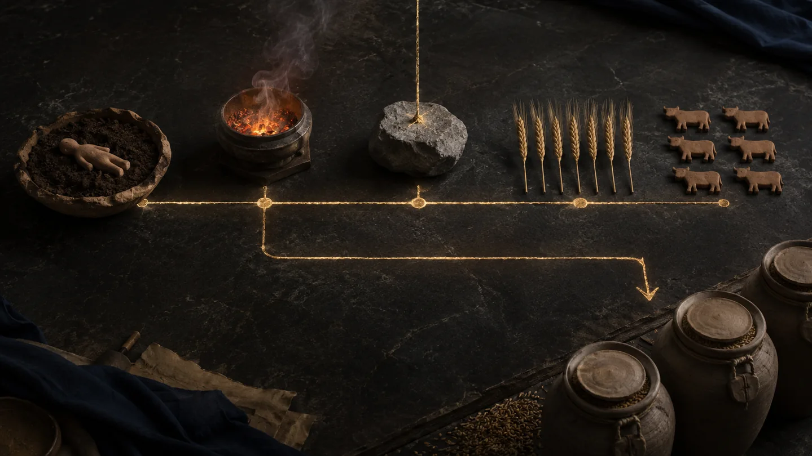

# ELOAH SCANNER — Texte original récupéré · Le sommeil des prophètes — Quand la conscience se retire | ELOAH

> **ARCHIVE DE LA PUBLICATION D'ORIGINE.** Contenu récupéré le 13 octobre 2026 sans réécriture depuis [la publication ELOAH Scanner](https://eloah-scanner.soniacointe.chatgpt.site/publications/sommeil-prophetes-conscience-retrait). La conversion HTML → Markdown peut modifier la présentation et ne garantit pas que tous les fichiers images soient inclus. [Index de Foi & Spiritualité](foi-control.html?file=eloah-foi-archives-completes-index.md).

---

## Visuels ELOAH retrouvés et réintégrés

Ces images proviennent des créations éditoriales ELOAH retrouvées dans la bibliothèque originale et remises en ligne en WebP optimisé. **Ce ne sont ni des photographies de manuscrits antiques, ni des reconstitutions archéologiques établies.** [Voir toute la galerie](foi-control.html?file=eloah-foi-galerie-originaux.md).

*Sommeil sous la lumière dorée — création éditoriale ELOAH, fichier antérieur retrouvé.*

*Fragments de rêves et fil d’or — création éditoriale ELOAH, fichier antérieur retrouvé.*

[ELOAH·](/)

ELOAH · Sommeil & Révélation · I

תַּרְדֵּמָה · חֲלוֹם · نَوْم · رُؤْيَا

# Le sommeil des prophètes

Quand la conscience se retire, que devient l’être humain ? Adam, Abraham, Jacob et Joseph : formation, alliance, passage, rêve, interprétation et retour à l’action dans la Bible et le Coran.

ELOAH · 32 scans · 5 annexes · 2026 · ~38 min

RETRAIT
VISION
INTERPRÉTATION
ACTION

# 0 · PROLOGUE

## Quand l’humain ne dirige plus la scène

Le sommeil retire à l’être humain une partie de ses commandes. Les yeux se ferment, la parole cesse, le corps s’abandonne et la maîtrise du monde extérieur diminue. Pourtant, dans les récits bibliques et coraniques, ce retrait n’est pas toujours un vide. Il peut devenir le lieu où quelque chose est formé, promis, montré ou demandé.

Il faut immédiatement poser une limite : tous les sommeils ne sont pas prophétiques, tous les rêves ne sont pas des révélations et toute image nocturne ne possède pas une signification cachée. Les textes eux-mêmes distinguent le sommeil profond, le songe signifiant, le rêve confus, l’avertissement et la vision dont le statut doit être interprété.

Le mot « prophètes » est ici un titre de série. Les classifications ne sont pas identiques dans la Bible et l’islam : Adam, Abraham, Jacob et Joseph n’y reçoivent pas partout le même titre formel. Nous suivrons donc leurs fonctions narratives sans écraser les différences confessionnelles.

La structure du dossier sera :

**RETRAIT → IMAGE → PAROLE → INTERPRÉTATION → RÉVEIL → ACTE → FRUIT**

> **Le sommeil devient transformateur non parce que l’inconscience serait sacrée en elle-même, mais parce que le personnage revient de son retrait avec une relation, une responsabilité ou une décision nouvelle.**

---

# 1 · LA CONSCIENCE

## Un mot moderne devant des textes anciens

Dire que « la conscience se retire » est une formulation contemporaine. La Bible hébraïque et le Coran ne disposent pas d’un terme correspondant exactement à toutes les significations modernes de « conscience » : vigilance, expérience subjective, jugement moral, connaissance de soi.

Dans ce dossier, le retrait désigne simplement la suspension partielle de la veille et de l’action volontaire. Il ne prétend pas décrire neurologiquement ce qui arrive au cerveau, ni décider métaphysiquement où va l’me.

Cette prudence évite deux erreurs : transformer les anciens récits en manuels de neurosciences, ou utiliser la science moderne pour annuler leur architecture symbolique. Le texte raconte ce que le sommeil fait dans une histoire ; la physiologie étudie comment dort un organisme. Les questions peuvent dialoguer, mais ne sont pas interchangeables.

---

# 2 · DORMIR EN HÉBREU

## יָשֵׁן · \*yāshēn\*

La famille hébraïque **י־ש־ן · Y-Š-N** porte l’idée de dormir. Le verbe ordinaire situe le personnage dans le sommeil ; il ne suffit pas à établir une révélation.

Dans les récits, dormir peut signifier la fatigue, la vulnérabilité, l’inaction ou le passage de la nuit. Jonas dort au fond du navire pendant la tempête : son sommeil n’est pas présenté comme un songe prophétique, mais comme un contraste avec le danger et l’agitation des marins.

Le sens naît donc de la scène complète : qui provoque le sommeil ? Une image apparaît-elle ? Une parole est-elle entendue ? Que fait le personnage au réveil ?

---

# 3 · LE SOMMEIL PROFOND

## תַּרְדֵּמָה · \*tardēmāh\*

La **tardēmāh** est un sommeil profond, un engourdissement ou un état d’abattement qui tombe sur une personne. Dans la Genèse, le terme apparaît notamment pour Adam en 2:21 et Abram en 15:12.

Le mot ne signifie pas automatiquement « rêve ». Adam ne raconte aucune image nocturne ; Abram reçoit une parole dans une scène de torpeur et d’effroi. Le même état de retrait remplit donc des fonctions différentes.

Dans d’autres livres bibliques, la *tardēmāh* peut signaler une insensibilité ou un sommeil envoyé qui empêche de percevoir. Le mot n’est pas positif par nature. Il marque une intensité du retrait dont la valeur dépend de ce qui l’entoure.

---

# 4 · LE RÊVE

## חֲלוֹם · \*ḥalōm\*

L’hébreu **חֲלוֹם · ḥalōm** désigne le rêve ou le songe. Le verbe apparenté exprime le fait de rêver. Dans la Genèse, il structure les récits de Jacob et surtout de Joseph.

Un *ḥalōm* peut être clair dans sa scène et obscur dans son sens. Joseph voit des gerbes et des astres ; Pharaon voit des vaches et des épis. L’image est mémorisable, mais sa portée doit être reconnue.

Le rêve biblique ne supprime donc pas l’interprète. Au contraire, il crée un écart entre ce qui est vu et ce qui doit être compris.

**VOIR N’EST PAS ENCORE SAVOIR.**

---

# 5 · DORMIR EN ARABE

## نَوْم · \*nawm\*

En arabe coranique, **نَوْم · nawm** désigne le sommeil. Le Coran parle aussi de somnolence, de repos nocturne et de la prise des mes pendant le sommeil.

[Coran 39:42](https://quran.com/39/42) rapproche la mort et le sommeil : Dieu reçoit les mes au moment de leur mort et celles qui ne meurent pas durant leur sommeil, puis retient les unes et renvoie les autres jusqu’à un terme fixé.

Le verset ne fournit pas une carte anatomique de l’me. Il place chaque nuit sous le signe d’une dépendance : s’endormir, c’est ne pas garantir soi-même son retour à la veille.

---

# 6 · LA VISION NOCTURNE

## رُؤْيَا · \*ruʾyā\* et أَحْلَام · \*aḥlām\*

Le Coran utilise **رُؤْيَا · ruʾyā** pour une vision ou un rêve marquant, notamment dans les récits d’Abraham et de Joseph. Il emploie aussi **أَحْلَام · aḥlām**, pluriel de *ḥulm*, dans l’expression **أَضْغَاثُ أَحْلَام · aḍghāthu aḥlām**, souvent traduite « amas de rêves confus ».

Cette différence ne doit pas être durcie en formule automatique où tout *ruʾyā* serait divin et tout *ḥulm* faux. Le contexte décide. Mais le vocabulaire permet au texte de mettre en scène un discernement entre une vision structurante et un mélange que les conseillers déclarent impossible à interpréter.

---

# 7 · ADAM

## Le premier retrait

En [Genèse 2:21](https://www.sefaria.org/Genesis.2.21), Dieu fait tomber une *tardēmāh* sur l’humain. Pendant qu’il dort, Dieu prend un côté — traditionnellement traduit « côte » — puis construit la femme.

Adam ne participe pas consciemment à l’opération. Il ne conçoit pas son vis-à-vis, ne choisit pas sa forme et ne se donne pas lui-même la relation. Le sommeil suspend sa maîtrise.

Ce retrait ne signifie pas que le corps serait sans importance. Au contraire, la transformation passe par le corps endormi : ouverture, prélèvement, fermeture, construction et présentation.

---

# 8 · LE CÔTÉ

## Une perte qui ouvre la relation

Le terme hébreu **צֵלָע · ṣēlāʿ** peut désigner un côté, un flanc ou une côte selon les contextes. La traduction anatomique ne doit pas masquer la structure : l’humain complet en apparence devient un être dont la relation passe par une différence reconnue.

À son réveil, l’humain parle. Sa première réaction rapportée n’est pas une explication technique de ce qui s’est produit, mais une reconnaissance : os de mes os, chair de ma chair.

Le sommeil d’Adam ne transmet donc pas un message à décoder. Il rend possible une réalité que la conscience éveillée reçoit après coup.

> **Adam ne rêve pas la relation : il se réveille devant elle.**

---

# 9 · ADAM DANS LE CORAN

## L’absence de la scène du sommeil

Le Coran raconte la création d’Adam, l’enseignement des noms, l’ordre adressé aux anges, le jardin, l’interdit et la chute. Il ne reprend pas la *tardēmāh* d’Adam ni la formation de la femme à partir de son côté.

Cette absence est importante. Une lecture comparée ne doit pas importer automatiquement la scène de Genèse 2 dans le Coran. Les deux corpus construisent l’humanité selon des séquences différentes.

Dans le Coran, le sommeil d’Adam n’est donc pas un lieu textuel de transformation. La transformation de son état passe plutôt par l’enseignement, l’épreuve, la faute, la réception de paroles et le retour.

---

# 10 · ABRAM

## Le soleil descend, la maîtrise aussi

En [Genèse 15:12](https://www.sefaria.org/Genesis.15.12), alors que le soleil se couche, une *tardēmāh* tombe sur Abram, accompagnée d’une grande obscurité et d’un effroi.

Le contexte est celui de l’alliance. Abram a demandé comment il saura qu’il possédera le pays promis. Des animaux sont préparés et séparés. Puis, au moment décisif, Abram ne marche pas lui-même entre les morceaux.

La torpeur marque une limite radicale : il reçoit la parole concernant l’avenir, mais ne contrôle ni son accomplissement ni le temps de l’histoire annoncée.

---

# 11 · L’EFFROI

## Le sommeil n’est pas toujours paisible

La scène d’Abram associe sommeil profond, terreur et grande obscurité. Elle résiste aux lectures qui transforment toute expérience spirituelle en douceur immédiate.

Le retrait de la conscience volontaire expose aussi à ce qui dépasse : descendance étrangère, oppression, durée et délivrance future. La promesse n’efface pas l’épreuve ; elle la traverse.

Ce sommeil ne fonctionne pas comme une échappatoire. Abram est retiré de l’action au moment où lui est montré que l’histoire ne dépendra pas de sa seule force.

---

# 12 · LE FEU QUI PASSE

## L’alliance sans symétrie

Après le coucher du soleil apparaissent un four fumant et une torche de feu passant entre les morceaux. Le signe mobile accomplit le passage que le corps d’Abram n’accomplit pas.

Dans les traités anciens, passer entre des animaux partagés peut engager celui qui prête serment. Ici la mise en scène souligne l’initiative divine. Abram reçoit l’alliance dans une position de non-maîtrise.

**QUESTION D’ABRAM → PRÉPARATION → TORPEUR → PAROLE → PASSAGE DU FEU → ALLIANCE**

Le sommeil est le point où l’action humaine s’arrête afin que l’initiative du récit devienne visible.

---

# 13 · ISAAC

## Dans la Genèse, l’épreuve n’est pas un rêve

Genèse 22 raconte l’ordre d’offrir Isaac, le voyage, le bois, la montée et l’interruption du geste. Le texte biblique ne présente pas cet ordre comme un rêve d’Abraham.

Cette précision est essentielle lorsqu’on compare la Bible et le Coran. Les deux récits partagent une épreuve liée au fils et à l’offrande, mais leur mise en scène n’est pas identique.

Dire que « dans les deux textes Abraham rêve qu’il doit sacrifier son fils » serait faux. Dans la Genèse, l’appel est raconté comme une parole divine adressée à Abraham ; le sommeil n’intervient pas.

---

# 14 · IBRĀHĪM

## « Je vois en rêve que je t’immole »

Dans [Coran 37:102](https://quran.com/37/102), Ibrāhīm dit à son fils qu’il voit en rêve qu’il l’immole et lui demande ce qu’il en pense. Le fils répond qu’il accomplisse ce qui lui est ordonné et promet, si Dieu le veut, d’être patient.

La vision n’est pas enfermée dans l’intériorité du père. Elle devient dialogue. Ibrāhīm ne cache pas l’image et n’agit pas silencieusement ; il la formule devant le fils.

Le rêve est ainsi placé entre vision et consentement verbal. Son autorité narrative n’abolit pas la relation.

---

# 15 · « JE VOIS »

## Une vision répétée

Le verset emploie une forme au présent : « je vois dans le sommeil ». Les commentateurs ont souvent compris cette formulation comme une vision répétée ou persistante.

Le texte ne donne pas le décor complet du songe. Il ne décrit ni ange, ni voix, ni scène développée. Il concentre la vision sur l’acte difficile.

Cette sobriété empêche de traiter le rêve comme spectacle. La question n’est pas l’esthétique de la nuit, mais ce que le père et le fils feront d’une vision éprouvante.

---

# 16 · LE FILS

## La parole introduit un second sujet

Ibrāhīm demande : « Vois ce que tu en penses. » Le fils n’est donc pas seulement l’objet silencieux de la vision. Il devient interlocuteur.

Le Coran ne nomme pas le fils dans cette scène. La tradition islamique l’identifie très largement à Ismāʿīl, tandis que des débats anciens ont existé. Il faut distinguer l’identification traditionnelle de la formulation du passage.

Le sommeil d’un seul devient ainsi une épreuve partagée par deux consciences éveillées. La vision ne se réalise pas directement : elle traverse la parole, la patience et la soumission.

---

# 17 · JACOB

## Dormir en fuite

En [Genèse 28](https://www.sefaria.org/Genesis.28.10-22), Jacob quitte Beer-Sheva vers Harn. Il s’arrête parce que le soleil s’est couché, prend une pierre du lieu, la place près de sa tête et s’endort.

Le rêve arrive dans un entre-deux : Jacob n’est plus dans la maison de son père et n’est pas encore arrivé chez Laban. Il est en déplacement, vulnérable, sans lit ni sanctuaire construit.

Le lieu apparemment quelconque devient espace de révélation. Ce n’est pas Jacob qui choisit un temple pour obtenir un oracle ; c’est la nuit du chemin qui devient porte.

---

# 18 · LA PIERRE

## Support, témoin, mémoire

La pierre accompagne le sommeil puis change de fonction au réveil. Jacob la dresse en stèle et verse de l’huile sur son sommet.

La matière muette devient support de mémoire. Elle ne produit pas le rêve, mais elle permet d’inscrire dans l’espace ce que le dormeur ne veut pas oublier.

**PIERRE PRÈS DE LA TÊTE → SOMMEIL → VISION → PIERRE DRESSÉE**

Le déplacement vertical de la pierre répond à la verticalité du rêve. Ce qui était couché avec Jacob se tient désormais comme témoin.

---

# 19 · L’ÉCHELLE

## סֻלָּם · \*sullām\*

Jacob voit un **sullām** dressé sur la terre dont le sommet atteint le ciel, avec des messagers divins montant et descendant. Le mot, rare, est souvent traduit « échelle », parfois « escalier » ou « rampe ».

La vision ne montre pas un Jacob qui escalade vers Dieu. Les messagers circulent ; Dieu se tient au-dessus ou près de lui selon les possibilités de traduction.

La structure est donc moins une technique d’ascension personnelle qu’une révélation de communication : le lieu de terre où Jacob dort n’est pas fermé au ciel.

---

# 20 · LA PROMESSE

## Une parole au milieu de l’image

Le rêve contient une parole de filiation, de terre, de descendance, de bénédiction et surtout de présence : Dieu promet d’être avec Jacob, de le garder et de le ramener.

L’image spectaculaire du passage vertical ne doit pas faire oublier ce noyau. Le rêve répond à la situation concrète du fuyard : solitude, déplacement et incertitude du retour.

La révélation ne retire pas Jacob de son chemin. Elle lui donne une promesse à porter pendant le chemin.

---

# 21 · LE RÉVEIL

## « Dieu était là et je ne savais pas »

Jacob se réveille et reconnaît qu’il ignorait la qualité du lieu. La transformation ne consiste pas en un déplacement physique pendant le sommeil, mais en une perception nouvelle du lieu où il se trouvait déjà.

Il éprouve de la crainte, nomme l’endroit **Béthel**, « maison de Dieu », dresse la pierre et prononce un vœu. Le réveil produit des actes de mémoire.

> **Le songe ouvre ; le réveil inscrit.**

Sans le lever, le nom et la pierre, la vision resterait une image privée. Jacob la transforme en orientation.

---

# 22 · JACOB ENCORE

## Les troupeaux et l’avertissement à Laban

La Genèse associe plus tard des rêves au départ de Jacob. En Genèse 31, Jacob rapporte une vision concernant les troupeaux et l’ordre de revenir vers sa terre. Dieu avertit également Laban en rêve de ne parler à Jacob ni en bien ni en mal.

Le rêve intervient alors dans un conflit économique et familial. Il ne construit plus un sanctuaire ; il protège un déplacement et limite la violence d’un poursuivant.

Le même personnage reçoit donc plusieurs nuits, mais celles-ci n’ont pas la même fonction : promettre une présence, relire une injustice, ordonner un retour, contenir une menace.

---

# 23 · JOSEPH

## Les gerbes

En [Genèse 37](https://www.sefaria.org/Genesis.37-50), Joseph rêve que les gerbes de ses frères s’inclinent devant la sienne. Il raconte le rêve, et ses frères l’interprètent immédiatement comme une prétention à régner.

Joseph ne fournit pas encore lui-même une explication. Le rêve produit son premier effet par sa narration : il augmente la haine.

La vision annonce une élévation future, mais la parole prématurée expose le rêveur. Recevoir une image ne signifie pas encore savoir quand, comment et à qui la dire.

---

# 24 · LE CIEL

## Soleil, lune et onze étoiles

Le second rêve élargit l’échelle : le soleil, la lune et onze étoiles se prosternent. Jacob réprimande Joseph et formule une interprétation familiale : lui, la mère et les frères devraient-ils s’incliner ?

Le texte ajoute cependant que le père garde la chose en mémoire. Réprimande extérieure et conservation intérieure coexistent.

Deux rêves forment une répétition qui augmente le poids narratif. Mais entre la vision et son accomplissement se trouvent la citerne, la vente, l’esclavage, la prison et des années d’attente.

---

# 25 · DIRE LE RÊVE

## Une vérité peut être mal située

Le récit de Joseph ne dit pas explicitement qu’il a menti ou inventé. Pourtant raconter ses rêves aggrave le conflit. La vérité possible d’une vision ne garantit donc pas la sagesse de son partage immédiat.

Cette distinction protège contre une logique dangereuse : « Puisque mon rêve est vrai, toute réaction des autres prouve qu’ils s’opposent à Dieu. » Le texte montre plutôt que le rêveur lui-même doit être transformé par le temps.

Joseph reçoit d’abord une image de pouvoir. Il apprendra ensuite à utiliser le pouvoir pour conserver la vie.

---

# 26 · YŪSUF

## Onze astres, le soleil et la lune

La sourate Yūsuf s’ouvre sur le jeune Joseph disant à son père qu’il a vu onze astres, le soleil et la lune se prosterner devant lui ([Coran 12:4](https://quran.com/12/4)). Le Coran ne reprend pas le premier rêve biblique des gerbes.

Cette différence resserre l’ouverture sur une seule vision cosmique. Le père en reconnaît immédiatement l’importance et avertit son fils.

Le rêve devient la clé de toute la sourate : annoncé au commencement, il est reconnu comme accompli à la fin lorsque la famille est réunie.

---

# 27 · NE RACONTE PAS

## Le discernement du destinataire

Yaʿqūb dit à Yūsuf de ne pas raconter sa vision à ses frères, de peur qu’ils ne trament un complot contre lui. La sagesse paternelle introduit une éthique de la réception.

Dans la Genèse, Joseph raconte les deux rêves à ses frères. Dans le Coran, le père tente immédiatement de protéger la vision de la jalousie.

| GENÈSE 37 | CORAN 12 |
| --- | --- |
| Deux rêves : gerbes puis astres | Une vision des astres |
| Les frères entendent directement | Le père recommande le secret |
| Jacob réprimande puis garde en mémoire | Yaʿqūb interprète comme signe d’élection et d’enseignement |

La comparaison révèle une pédagogie différente de la parole.

---

# 28 · LA PRISON

## Deux rêves, deux destins

Dans la prison, deux serviteurs du souverain racontent leurs rêves. L’un voit une vigne ou se voit presser du vin ; l’autre porte du pain que des oiseaux mangent. Joseph/Yūsuf annonce la restauration de l’un et la mort de l’autre.

Les images se ressemblent par leur lien au service royal et à la nourriture, mais elles conduisent à des issues opposées.

Le rêve n’est pas un langage dont chaque objet aurait partout un sens fixe. La vigne ne signifie pas toujours la même chose, ni l’oiseau, ni le pain. L’interprétation appartient à la relation entre image, personne, contexte et révélation.

---

# 29 · L’INTERPRÉTATION

## Elle ne vient pas de l’ego

En Genèse 40:8, Joseph affirme que les interprétations appartiennent à Dieu. En Genèse 41:16, devant Pharaon, il refuse de s’attribuer la capacité autonome de répondre.

Dans la sourate 12, Yūsuf relie son savoir à ce que son Seigneur lui a enseigné et insère l’interprétation dans un discours sur l’unicité divine.

Le véritable interprète n’est donc pas présenté comme propriétaire d’un code secret. Il reçoit, discerne et répond. Cette limite sépare le service du rêve de son exploitation.

> **L’interprète fidèle ne devient pas le maître de l’invisible.**

---

# 30 · LE ROI

## Sept vaches et sept épis

Le souverain voit sept vaches grasses dévorées par sept maigres, ainsi que sept épis verts et sept autres desséchés. Ses conseillers parlent de rêves confus. Le serviteur restauré se souvient alors de Joseph/Yūsuf.

La scène déplace le pouvoir. Le roi possède le rêve mais pas son sens. Le prisonnier possède une lecture mais pas encore la liberté.

Dans la Bible, les deux rêves de Pharaon sont déclarés un seul message répété. Dans le Coran, Yūsuf interprète les séries et formule directement une stratégie agricole.

---

# 31 · DU RÊVE AU GRENIER

## La preuve par l’application

Joseph ne se contente pas d’annoncer sept années d’abondance puis sept années de famine. Il propose de cultiver, de laisser le grain dans ses épis, de consommer avec mesure et de conserver des réserves.

Le rêve devient administration. L’invisible ne remplace ni les calculs, ni les greniers, ni le travail collectif.

**VACHES ET ÉPIS → ANNÉES → PRÉVISION → STOCKAGE → SURVIE**

C’est ici que la vision trouve son fruit le plus vérifiable : non la fascination pour l’image, mais la capacité de protéger des vies face à une crise annoncée.

---

# 32 · SYNTHÈSE

## Revenir différent

Les sommeils parcourus ne forment pas une seule technique spirituelle.

**Adam** s’endort sans rêve rapporté ; il se réveille devant une relation qu’il n’a pas fabriquée.

**Abram** tombe dans la torpeur ; l’alliance passe par une initiative qu’il ne contrôle pas.

**Ibrāhīm** reçoit une vision éprouvante ; il la transforme en dialogue avec son fils.

**Jacob** dort en fuite ; il se réveille capable de reconnaître, nommer et dresser une pierre.

**Joseph/Yūsuf** voit d’abord son avenir sous forme symbolique ; après l’épreuve, il interprète les rêves des autres et transforme la vision du roi en politique de sauvegarde.

Le retrait n’est donc ni l’objectif ni la preuve. Le critère se situe au retour.

> **Le sommeil ouvre une brèche dans la maîtrise. La transformation commence lorsque l’être réveillé convertit ce qu’il a reçu en relation, discernement, patience et action juste.**

Un rêve qui ne produit que supériorité ou dépendance envers l’interprète doit être questionné. Dans les grands récits de la Genèse et de la sourate Yūsuf, la vision la plus haute finit par rejoindre la matière : une personne, une pierre, un chemin, des épis et du pain conservé pour les vivants.

---

# ANNEXE I · CARTE DES SOMMEILS

| PERSONNAGE | TEXTE | FORME | CONTENU | FRUIT AU RÉVEIL |
| --- | --- | --- | --- | --- |
| Adam | Genèse 2 | *tardēmāh* | aucun rêve rapporté | relation reconnue |
| Abram | Genèse 15 | *tardēmāh* et vision | obscurité, parole, feu | alliance reçue |
| Ibrāhīm | Coran 37 | *ruʾyā* | immolation du fils | dialogue, épreuve, substitution |
| Jacob | Genèse 28 | *ḥalōm* | passage terre-ciel, promesse | lieu nommé, pierre dressée, vœu |
| Joseph | Genèse 37 | deux rêves | gerbes, astres | conflit puis accomplissement différé |
| Yūsuf | Coran 12 | vision | onze astres, soleil, lune | récit conservé puis reconnu |
| Deux prisonniers | Genèse 40 / Coran 12 | rêves parallèles | vigne, pain, oiseaux | deux destins annoncés |
| Pharaon / roi | Genèse 41 / Coran 12 | deux ensembles symboliques | vaches et épis | politique de réserves |

---

# ANNEXE II · LEXIQUE

| LANGUE | FORME | SENS PRINCIPAL | PRUDENCE |
| --- | --- | --- | --- |
| Hébreu | יָשֵׁן · *yāshēn* | dormir | ne suppose pas une révélation |
| Hébreu | תַּרְדֵּמָה · *tardēmāh* | sommeil profond, torpeur | peut avoir plusieurs valeurs narratives |
| Hébreu | חֲלוֹם · *ḥalōm* | rêve, songe | le sens dépend de l’interprétation |
| Arabe | نَوْم · *nawm* | sommeil | état humain général |
| Arabe | رُؤْيَا · *ruʾyā* | vision, rêve marquant | le contexte établit son statut |
| Arabe | حُلْم / أَحْلَام · *ḥulm / aḥlām* | rêve(s) | peut apparaître dans l’expression des rêves confus |
| Arabe | تَأْوِيل · *taʾwīl* | interprétation, aboutissement | ne se réduit pas à un dictionnaire de symboles |

---

# ANNEXE III · CE QUE LES TEXTES NE DISENT PAS

* La Genèse ne raconte aucun rêve d’Adam pendant son sommeil profond.
* Le Coran ne reprend pas le sommeil d’Adam ni la création de la femme à partir d’un côté.
* Genèse 22 ne présente pas l’épreuve d’Isaac comme un rêve.
* Le Coran ne nomme pas le fils dans la scène de la vision d’Ibrāhīm en 37:102.
* Le Coran ne raconte pas le rêve des gerbes de Joseph.
* La Bible et le Coran ne fournissent pas un dictionnaire universel où chaque symbole onirique possède toujours le même sens.
* Le verset coranique 39:42 ne constitue pas une description neurologique du sommeil.
* Un rêve intense, répétitif ou religieux n’est pas, par cette seule intensité, authentifié comme révélation.

---

# ANNEXE IV · LES SEPT ÉTAPES

| ÉTAPE | QUESTION |
| --- | --- |
| Retrait | Qu’est-ce qui cesse d’être contrôlé ? |
| Image | Qu’est-ce qui est réellement vu dans le texte ? |
| Parole | Le rêve est-il raconté, gardé ou annoncé ? |
| Interprétation | Qui relie l’image au sens, et avec quelle autorité ? |
| Réveil | Qu’est-ce que le personnage reconnaît ? |
| Acte | Quel geste concret suit la vision ? |
| Fruit | La lecture protège-t-elle, relie-t-elle et résiste-t-elle au réel ? |

---

# ANNEXE V · MÉTHODE ELOAH

**SCANNER** — distinguer sommeil ordinaire, torpeur, songe et vision.

**RACINE** — ouvrir *tardēmāh*, *ḥalōm*, *nawm* et *ruʾyā* sans imposer une équivalence parfaite.

**STRUCTURE** — suivre le passage du retrait vers le réveil et l’acte.

**MESURER** — compter les rêves en paires, leurs répétitions et leurs accomplissements narratifs.

**LIER** — comparer les récits bibliques et coraniques sans importer dans l’un les détails de l’autre.

**PROUVER** — séparer le verset, l’exégèse, la tradition et l’application contemporaine.

**APPLIQUER** — ne pas demander seulement « que signifie mon rêve ? », mais « quelle décision juste, vérifiable et non violente cette lecture produit-elle ? »

Le rêve n’est pas une couronne posée sur le dormeur. Il est une responsabilité donnée à celui qui se relève.